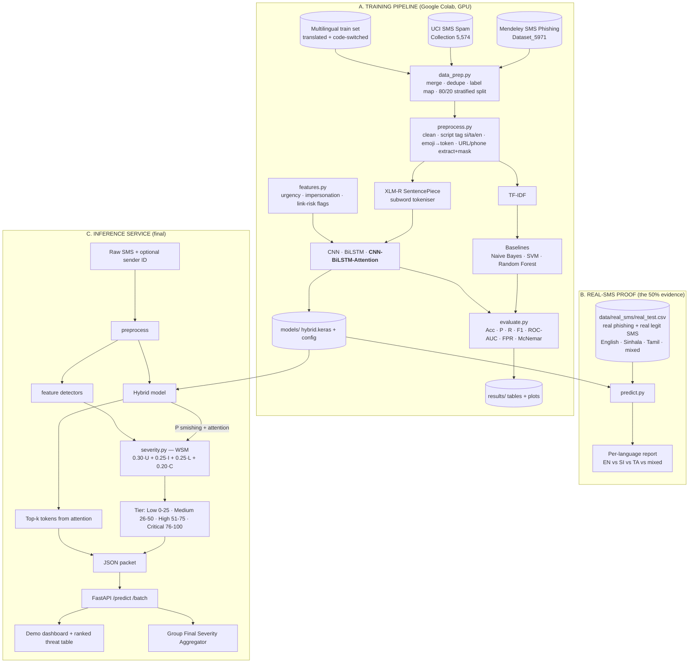

# Final System Architecture — Smishing Detector (Component 2, J26-IT-424)

Hybrid CNN-BiLSTM multilingual SMS phishing detector with severity-aware risk scoring.
This is the **target final output**. The 50% milestone builds the shaded core (training + testing on real SMS); the rest is completed for 100%.

## 1. Big picture



## 2. Hybrid model (inside the box)

```
Input tokens (max 64 subwords)          Handcrafted flags (8 values)
        │                                        │
Embedding (XLM-R vocab, 128-d, trainable)        │
        │                                        │
Conv1D k=2 ─┐                                    │
Conv1D k=3 ─┼─ concat (parallel filters, 64 each)│
Conv1D k=4 ─┘                                    │
        │                                        │
BiLSTM (64 units each way, return sequences)     │
        │                                        │
Attention  ──► token weights (explainability)    │
        │                                        │
Context vector ──────────── concat ──────────────┘
        │
Dense 64 + Dropout 0.4
        │
Sigmoid → P(smishing)
```

## 3. Module map (repo)

| File | Job | Milestone |
|---|---|---|
| `src/data_prep.py` | Load UCI + Mendeley, dedupe, map labels, fixed split → `data/processed/` | 50% |
| `src/preprocess.py` | Cleaning, script tagging, emoji/URL/phone handling | 50% |
| `src/features.py` | Urgency / impersonation / link-risk detectors from `lexicons/` | 50% |
| `src/baselines.py` | TF-IDF + NB / SVM / RF | 50% |
| `src/model.py` | CNN, BiLSTM, CNN-BiLSTM-Attention builders | 50% |
| `src/evaluate.py` | Metrics, confusion matrix, ROC, per-language split, McNemar | 50% |
| `src/severity.py` | WSM score + tier | 50% (v1) |
| `src/predict.py` | One function: text → label, prob, score, tier, top tokens | 50% |
| `api/main.py` | FastAPI service | 100% |
| `demo/` | Paste-an-SMS page + ranked table | 100% |

## 4. Output JSON (shared with the group aggregator)

```json
{
  "component": "SMS",
  "message_id": "sms-000123",
  "label": "smishing",
  "confidence": 0.94,
  "score": 86.5,
  "tier": "Critical",
  "sub_scores": {"urgency": 0.90, "impersonation": 0.85, "link_risk": 0.80, "model_confidence": 0.94},
  "language": "si-en",
  "top_tokens": [["OTP", 0.21], ["bit.ly", 0.18], ["ඉක්මනින්", 0.11]],
  "model_version": "cnn-bilstm-att-1.0",
  "timestamp": "2026-09-25T10:00:00Z"
}
```
Agree this schema with the other three members early — it is the integration contract.

## 5. Changes from the proposal (recommended, easier and more defensible)

| Proposal said | Change to | Why |
|---|---|---|
| Binary smishing vs legitimate | **1 = smishing OR spam, 0 = ham** (keep the 3-way label too) | Mendeley has 3 classes; your own Low tier is "promotional spam", so spam must be in the positive class. |
| Use UCI + Mendeley together | **Merge then remove duplicates** | Mendeley reuses many UCI messages; duplicates across train/test inflate accuracy — examiners check this. |
| SMOTE on training data | **Class weights** (`class_weight='balanced'`) | SMOTE interpolates numeric vectors; it is meaningless on token-ID sequences. Keep SMOTE only as an optional TF-IDF baseline experiment. |
| Train own SentencePiece | **Use the pretrained XLM-R SentencePiece tokeniser** | Still SentencePiece subwords, but already covers Sinhala + Tamil scripts; you have far too little Sinhala/Tamil text to train one. |
| Multilingual set = validation only | **Also build a small multilingual *training* set** (~300–600 translated/code-switched messages) | A model trained only on English cannot reach 85% F1 on Sinhala/Tamil. Keep the real-SMS test set 100% separate. |
| 10-fold CV for everything | **10-fold for baselines, 5-fold for deep models** | Same rigour, fits Colab time. |
| Impersonation = sender ID vs claimed brand | **Sender ID optional**; text-only brand/authority matching by default | Public datasets have no sender ID. |
